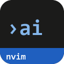
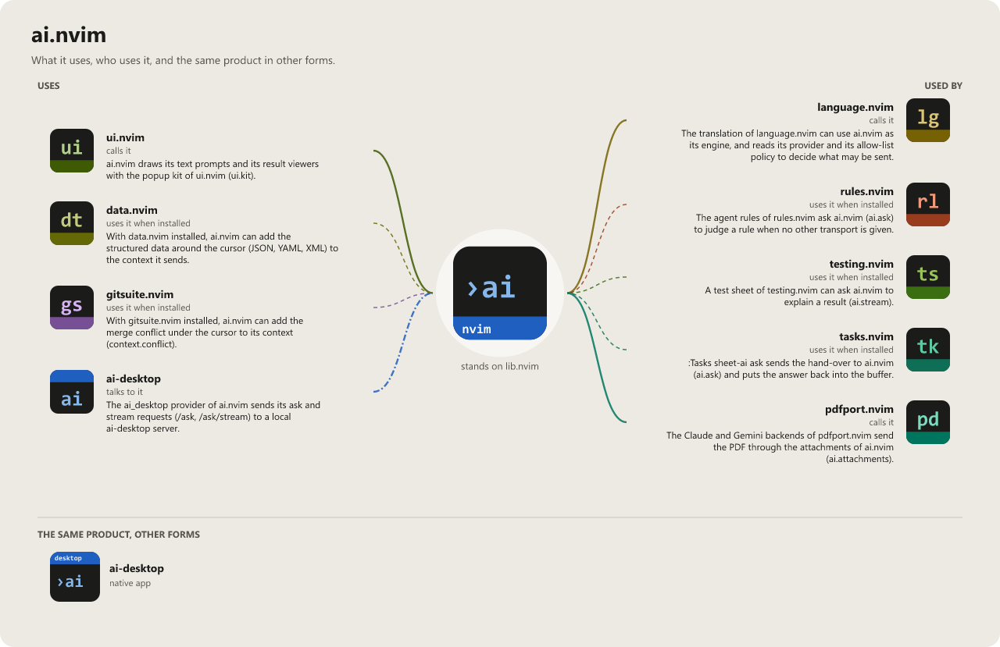

> **Beta stage — active development.** This repository is past its first shape and in
> active use, but the surface is not frozen: breaking changes are still possible. Pin a
> commit or tag if you depend on it.

# ai.nvim

```
   █████╗ ██╗
  ██╔══██╗██║
  ███████║██║
  ██╔══██║██║
  ██║  ██║██║
  ╚═╝  ╚═╝╚═╝
                                               .nvim
```

> Pairs well with [pdfport.nvim](https://github.com/WKDSteve/pdfport.nvim):
> its `claude`/`ollama` extraction backends send their PDFs and page images
> through this plugin's `ask()`, rather than carrying a second hand-written
> curl/provider path of their own. That migration is what
> [attachments](docs/attachments.md) were built for.

[](LICENSE)
[](https://neovim.io)
[](https://www.lua.org)


[](https://github.com/WKDSteve/ai.nvim/actions/workflows/ci.yml)
[](https://wkdsteve.github.io/wkd/p/ai/)

> Part of the [wkd](https://wkdsteve.github.io/wkd/) family — see this plugin's [page](https://wkdsteve.github.io/wkd/p/ai/) on the site.

A provider-agnostic ask/stream layer for talking to an AI from inside Neovim --
context assembly (buffer/selection/diagnostics), a streaming answer panel, and
one `:Ai` command, instead of every plugin hand-rolling its own curl calls.

---

## Table of contents

- [Documentation](#documentation)
- [Literatur und Referenzen](#literatur-und-referenzen)
- [License](#license)

---

## Documentation

Start at [docs/README.md](docs/README.md) -- what's where, and which question
each page answers.

### The Basics

- [Requirements](docs/requirements.md) -- Neovim version, required plugins and CLI tools.
- [Installation](docs/installation.md) -- plugin managers and load-trigger variants.
- [Quickstart](docs/quickstart.md) -- the first thing to run after installing.

### Configuration

- [All options](docs/configuration.md) -- every `setup()` option and its default.
- [Commands](docs/commands.md) / [Bindings cheatsheet](docs/BINDINGS.md)
- [Attachments](docs/attachments.md) -- sending an image or a PDF with a prompt.
- [Bulk requests](docs/bulk.md) -- the guard rails for plugins that send a whole document in many requests.
- Usage reporting (`:help ai-usage`) -- opt-in: `usage = { report = true }` sends one metadata event per request (provider, model, tokens, duration, outcome -- never any text) to a local ai-desktop server (see [scope](docs/scope.md)), which keeps the usage log and shows it on its dashboard.

### The Rest

- [What it does and what not](docs/scope.md) -- the boundary with `ai-desktop`.
- [Why it does it that way](docs/architecture.md)
- [Health check](docs/health.md) -- what `:checkhealth ai` reports, line by line.
- [Feedback](https://github.com/WKDSteve/ai.nvim/issues)

`:help ai` is the same reference inside the editor.

---

## Literatur und Referenzen

- [gp.nvim](https://github.com/Robitx/gp.nvim) -- a chat and prompt plugin for Neovim; a close relative of what this plugin does.
- [minuet-ai.nvim](https://github.com/milanglacier/minuet-ai.nvim) -- LLM code completion for Neovim; the neighbouring approach to the same problem.
- [Anthropic Messages API](https://platform.claude.com/docs/en/api/messages) -- the API behind the `claude` provider.
- [OpenAI API reference](https://developers.openai.com/api/reference/overview) -- the API behind the `openai` provider.
- [Ollama API](https://github.com/ollama/ollama/blob/main/docs/api.md) -- the local API behind the `ollama` provider.

---

## License

ai.nvim is released under the [MIT License](https://opensource.org/licenses/MIT) -- see [LICENSE](LICENSE).

<!-- connections:begin (written by the app-icons tool of the workshop; change integrations.json there, not this block) -->
## Connections



**Uses**

- [ai-desktop](https://github.com/WKDSteve/ai-desktop): The `ai_desktop` provider of ai.nvim sends its ask and stream requests (`/ask`, `/ask/stream`) to a local ai-desktop server. ([picture](assets/graphs/pair/ai.nvim--ai-desktop.png))
- [data.nvim](https://github.com/WKDSteve/data.nvim): With data.nvim installed, ai.nvim can add the structured data around the cursor (JSON, YAML, XML) to the context it sends. ([picture](assets/graphs/pair/ai.nvim--data.nvim.png))
- [gitsuite.nvim](https://github.com/WKDSteve/gitsuite.nvim): With gitsuite.nvim installed, ai.nvim can add the merge conflict under the cursor to its context (`context.conflict`). ([picture](assets/graphs/pair/ai.nvim--gitsuite.nvim.png))
- [ui.nvim](https://github.com/WKDSteve/ui.nvim): ai.nvim draws its text prompts and its result viewers with the popup kit of ui.nvim (`ui.kit`). ([picture](assets/graphs/pair/ai.nvim--ui.nvim.png))
- [lib.nvim](https://github.com/WKDSteve/lib.nvim): the shared base of the plugins.

**Used by**

- [language.nvim](https://github.com/WKDSteve/language.nvim): The translation of language.nvim can use ai.nvim as its engine, and reads its provider and its allow-list policy to decide what may be sent. ([picture](assets/graphs/pair/language.nvim--ai.nvim.png))
- [pdfport.nvim](https://github.com/WKDSteve/pdfport.nvim): The Claude and Gemini backends of pdfport.nvim send the PDF through the attachments of ai.nvim (`ai.attachments`). ([picture](assets/graphs/pair/pdfport.nvim--ai.nvim.png))
- [rules.nvim](https://github.com/WKDSteve/rules.nvim): The agent rules of rules.nvim ask ai.nvim (`ai.ask`) to judge a rule when no other transport is given. ([picture](assets/graphs/pair/rules.nvim--ai.nvim.png))
- [tasks.nvim](https://github.com/WKDSteve/tasks.nvim): `:Tasks sheet-ai ask` sends the hand-over to ai.nvim (`ai.ask`) and puts the answer back into the buffer. ([picture](assets/graphs/pair/tasks.nvim--ai.nvim.png))
- [testing.nvim](https://github.com/WKDSteve/testing.nvim): A test sheet of testing.nvim can ask ai.nvim to explain a result (`ai.stream`). ([picture](assets/graphs/pair/testing.nvim--ai.nvim.png))
<!-- connections:end -->
